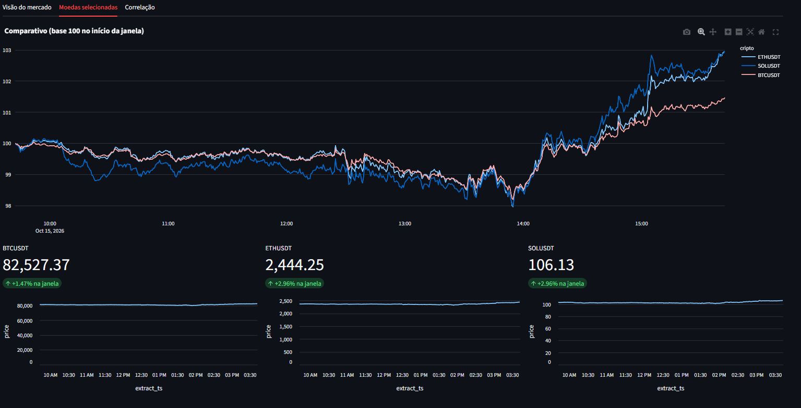
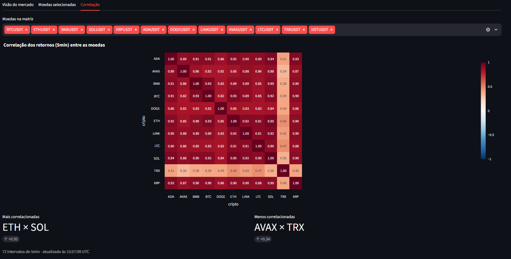
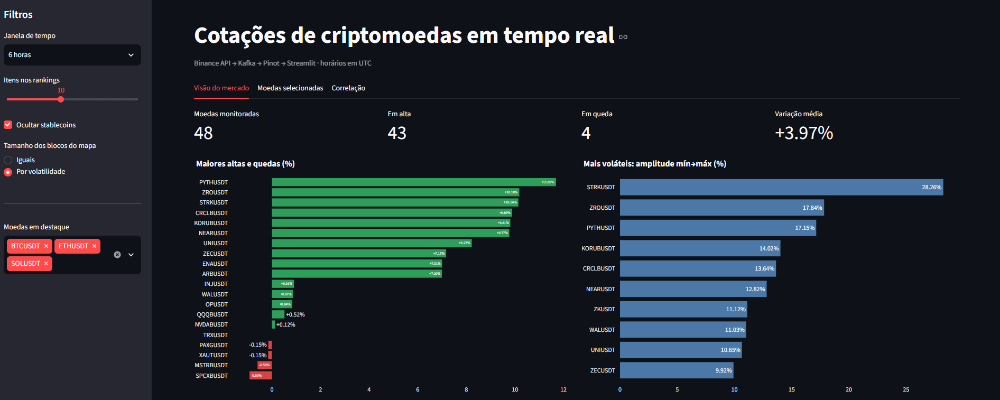

# Dashboard de Cotações de Criptomoedas em Tempo Real


Projeto de engenharia e análise de dados desenvolvido para monitorar cotações de criptomoedas da Binance em tempo real, utilizando uma arquitetura de streaming com Apache Kafka e Apache Pinot, com visualização dos dados por meio de um dashboard interativo desenvolvido em Streamlit.

Todo o ambiente sobe com **um único comando** e só exige Docker.

## Dashboard


## Stack ultilizada:
- **Docker**: containerização e orquestração
- **Apache Kafka**: Serviço de mensageria 
- **Apache Pinot**: Banco OLAP para analise em tempo real
- **Streamlit**: Biblioteca para criação do Dashboard
- **Python**: Para criação do producer e aplicação
- **API Binance**: Fonte dos dados

## Arquitetura 
1. **Coleta**: Um producer desenvolvido em Python consulta a API da Binance a cada 30 segundos, obtendo dados das 50 principais moedas selecionadas.
2. **Streaming**: As cotações são publicadas em um tópico do Apache Kafka.
3. **Ingestão e consulta**:  Apache Pinot consome os eventos do Kafka por meio de uma tabela do tipo REALTIME, permitindo consultas analíticas sobre os dados ingeridos.
4. **Visualização**: O Streamlit consulta o Pinot e apresenta as informações em um dashboard interativo.
## Pré-requisitos 
- Docker
- Docker-compose
- Recomendado: ~8G de RAM para o Docker

## Como executar o projeto
1. **Clone o repositório**
``` bash 
git clone https://github.com/kayan-cardoso/kafka_streaming_binance.git
cd kafka_streaming_binance
```
2. **Inicie a infraestrutura**
``` bash
docker compose up -d
``` 
Na primeira execução, aguarde de 1 a 2 minutos até o Pinot ficar saudável.

3. **Verifique os containers**

``` bash
docker compose ps 
```
4. **Acesse o Dash**
- Espere a aplicação subir e abra seu navegador e acesse `http://localhost:8501`

5. **Para encerrar a infraestrutura**
``` bash 
docker compose down 
```

## Objetivo do projeto

O objetivo deste projeto é aplicar conceitos e ferramentas de Engenharia de Dados, com foco na construção de um pipeline de dados em tempo real.

A arquitetura integra a coleta de dados via API, a publicação e o transporte de eventos com Apache Kafka, a ingestão contínua e as consultas analíticas com Apache Pinot, além da containerização dos serviços com Docker e Docker Compose.

O projeto explora conceitos como pipelines de streaming, ingestão de dados em tempo real e integração entre serviços, utilizando o Streamlit como camada de visualização para os dados processados.

## Decisões de projeto
 
- **API pública em vez de banco corporativo.** A ideia inicial era capturar mudanças (CDC) de um Postgres com Debezium. Usar um banco real num projeto público traz risco de dados sensíveis e deixa o repositório irreproduzível, então a fonte virou a API pública da Binance, que não exige credenciais.
- **Bootstrap automático do Pinot.** O container `pinot-init` espera o Controller ficar saudável e cria schema e tabela. É idempotente: se a tabela já existe, não faz nada.
- **Persistência com volumes nomeados.** Um `docker compose down` não apaga os dados do Kafka nem do Pinot. Apenas `down -v` faz isso.
- **UTC como padrão.** Os timestamps são gerados e armazenados em UTC. A conversão para o fuso local, se necessária, fica na camada de visualização.
- **Sem key nas mensagens.** O dashboard ordena por `extract_ts`, então a ordem entre partições não afeta o resultado. Em escala maior, usar o símbolo como key seria o próximo passo.
- **Dependências do dashboard isoladas.** Ficam em um grupo `dashboard` do `uv`, para não inflar a imagem do producer.

## Visualizações



## ⚠️ Aviso
 
Projeto com fins educacionais e de portfólio. Os dados vêm da API pública da Binance e **não constituem recomendação de investimento**.
 
 
## Autor
 
**Kayan Cardoso**

[GitHub](https://github.com/kayan-cardoso) · [LinkedIn](https://www.linkedin.com/in/kayancardoso)